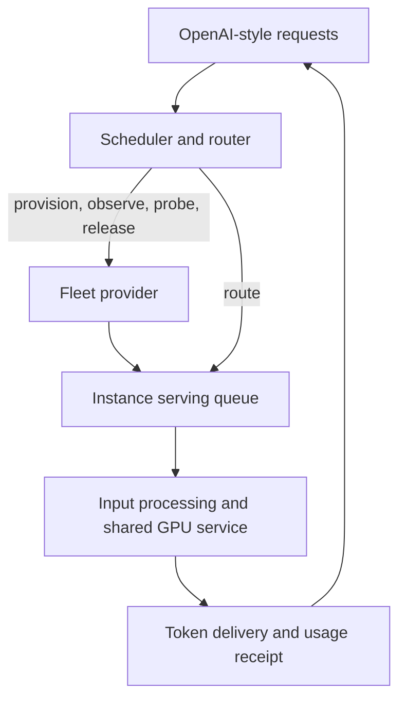

# Switchyard

Switchyard is a Rust toolkit for developing inference schedulers and routers. Its fleet simulator models rented GPU instances, model startup, bounded serving queues, shared GPU capacity, token delivery, and billing. A scheduler uses known input tokens, estimated output lengths, workload plans, and host observations to decide where to route requests and when to acquire or release capacity.

| Component | What it provides |
| --- | --- |
| [Simulator](crates/switchyard-sim) | Deterministic workload replay and a local HTTP GPU-provider API with synthetic OpenAI-compatible serving |
| [Scheduler and router](crates/switchyard-scheduler) | Five reference policies, queue admission, capacity planning, and adaptive host probing |
| [Test gauntlet](crates/switchyard-gauntlet) | Analytical fixtures, workload comparisons, seeded generated tests, and software performance measurements |
| [Shared contracts](crates/switchyard-core) | Configuration, known request inputs, observable fleet state, and the pluggable `Scheduler` interface |

The simulator runs locally and produces synthetic text. It does not load model weights or contact a GPU provider. Profiles distinguish observations, adjusted estimates, and assumptions; simulated throughput is an experiment against a profile.

## Quickstart

Use Rust 1.98 or later. Switchyard uses Rust edition 2024. From this checkout, compare all policies on the checked-in twelve-call workload:

```sh
cargo run --locked --release --example replay
```

The example uses [configs/quickstart](configs/quickstart), which contains two analytical GPU offerings, a workload trace, and an HTTP environment. To edit and replay that configuration with a selected policy:

```sh
cargo run --locked --release -- run \
  --profiles configs/quickstart/profiles.json \
  --scenario configs/quickstart/burst.json \
  --policy adaptive --out results/quickstart.json
```

A run records request timings, per-instance cost, unfinished work, controller diagnostics, and a fleet timeline. `desired_output_tps` is a workload goal; the result reports whether delivered completions met it. Planned output is an estimate, while the hard output limit controls memory admission. The scheduler cannot read future output lengths or sampled host conditions.

Install the CLI from this checkout with `cargo install --path . --locked`, then use `switchyard` in place of `cargo run --release --`.

## HTTP experiments

Start a local provider with the same analytical configuration:

```sh
cargo run --locked --release -- serve \
  --profiles configs/quickstart/profiles.json \
  --environment configs/quickstart/environment.json \
  --bind 127.0.0.1:8080
```

Send an OpenAI-style request to the convenience router. The bundled controller selects an existing host or provisions one:

```sh
curl http://127.0.0.1:8080/v1/chat/completions \
  -H 'Content-Type: application/json' \
  -d '{"model":"demo-model","messages":[{"role":"user","content":"Hello"}],"max_tokens":32,"stream":true}'
```

For an independent scheduler, use `/v1/offerings` and `/v1/instances` to provision and observe hosts, then send requests to an instance's serving endpoint. Instance queues represent serving-engine admission; the router's queue determines which instance receives a request. The [HTTP client example](examples/http_scheduler.rs) exercises both paths.

`--clock-rate 1` advances one simulated second per real second. Set it to zero for manual advancement through `/control/advance`, or increase it for accelerated experiments. See [API behavior](docs/API.md) for schemas, streaming, probes, and clock control.



## Workload comparisons and validation

| Command | Purpose |
| --- | --- |
| `init --out data` | Export editable profiles, provider configuration, and sixteen workload traces |
| `validate --profiles … --scenario …` | Check a custom trace and catalog before replay |
| `run --profiles … --scenario … --policy adaptive` | Replay one workload |
| `suite --seeds 3 --out results/suite` | Compare all reference policies over the default workloads |
| `fuzz --cases 1000 --seed 42 --out results/fuzz` | Generate workloads and save failing cases for replay |
| `bench --sizes 1,100,1000,10000 --repetitions 3` | Measure simulator CPU execution time |

Run commands with `switchyard` after installation, or with `cargo run --locked --release --` from the checkout. The reference policies are warm-only, reactive, cheapest-elastic, planned-hybrid, and adaptive. Their tradeoffs depend on the workload and hardware assumptions.

```sh
cargo fmt --all -- --check
cargo clippy --locked --workspace --all-targets -- -D warnings
cargo test --locked --workspace --all-targets
RUSTDOCFLAGS='-D warnings' cargo doc --locked --workspace --no-deps
cargo run --locked --release -- fuzz --cases 1000 --seed 42
```

Use `--workspace` to include every package's tests. The `bench` command measures software overhead separately from virtual GPU throughput; `--max-seconds` optionally enforces a host-specific regression budget. Generated results and local experiment data are ignored by Git.

## Project structure

```text
crates/
  switchyard-core/       # Configuration and scheduling contracts
  switchyard-scheduler/  # Policies and routing runtime
  switchyard-sim/        # Physical engine and HTTP provider
  switchyard-gauntlet/   # Workloads, integration tests, and benchmarks
src/                    # CLI and library facade
configs/                # Runnable JSON recipes
examples/               # Library and HTTP client examples
docs/                   # Architecture, API, calibration, and results
```

Implement `Scheduler::decide(&FleetView)` to test another controller. The scheduler package depends on the shared contracts; the simulator accepts a controller through that interface. Workspace dependencies, Rust requirements, and lints live in the root manifest.

| Guide | Subject |
| --- | --- |
| [Architecture](docs/ARCHITECTURE.md) | Package boundaries, event timing, physical approximations, and scheduling decisions |
| [Configuration](docs/CONFIGURATION.md) | Fields, units, validity rules, and experiment controls |
| [API](docs/API.md) | Provider lifecycle, request admission, token streaming, and observations |
| [Calibration](docs/CALIBRATION.md) | Measurement provenance and capacity-profile construction |
| [Validation and results](docs/RESULTS.md) | Test coverage, reproducible comparisons, and known limitations |
| [Repository design](docs/REPOSITORY.md) | Organization patterns studied in other open-source projects |
| [Contributing](CONTRIBUTING.md) | Development checks and requirements for behavioral evidence |

## Model boundaries

GPU service uses aggregate capacity curves with weighted sharing. It does not emulate GPU kernels, decode iterations, or tensor-parallel communication. KV admission reserves input plus the hard output limit; network bandwidth is a per-request link approximation. Host image and model caches affect startup, while prompt-cache savings are supplied as an input estimate.

The serving fixture supports synthetic chat completions and streaming. It does not evaluate model quality or implement every OpenAI API. Text token counts use a documented byte-based approximation when explicit simulator metadata is absent. The default catalog includes historical calibration with incomplete evidence; the quickstart recipe uses clearly marked analytical assumptions.

MIT licensed.
