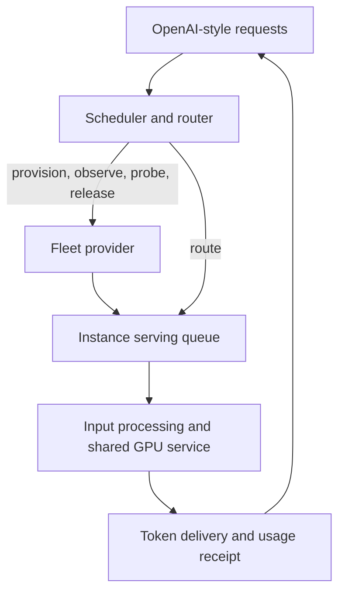

# Switchyard

Switchyard is a Rust toolkit for developing inference schedulers and routers. Its fleet simulator models rented GPU instances, model startup, bounded serving queues, shared GPU capacity, token delivery, and billing. A scheduler uses known input tokens, estimated output lengths, workload plans, and host observations to decide where to route requests and when to acquire or release capacity.

| Component | What it provides |
| --- | --- |
| [Simulator](crates/switchyard-sim) | Deterministic workload replay and a local HTTP GPU-provider API with synthetic OpenAI-compatible serving |
| [Scheduler and router](crates/switchyard-scheduler) | Five reference policies, queue admission, capacity planning, and adaptive host probing |
| [Test gauntlet](crates/switchyard-gauntlet) | Analytical fixtures, workload comparisons, seeded generated tests, and software performance measurements |
| [Live execution](crates/switchyard-live) | The same scheduler contract driving real RunPod pods and OpenAI-compatible vLLM, SGLang, or native Rust streams |
| [Provider adapters](crates/switchyard-provider) | Timestamped rental offers, owned pod lifecycle, and S3-compatible storage signing |
| [Pod agent](crates/switchyard-agent) | Rust hydration, observed startup progress, and authenticated model transport |
| [Artifacts](crates/switchyard-artifacts) | Deterministic archives, integrity checks, bounded transfer, and atomic hydration without cloud or engine dependencies |
| [Weight loading](crates/switchyard-weights) | Header-first safetensors publication and completion leases for incremental vLLM weight loading through the pod agent |
| [Artifact tools](crates/switchyard-artifact-tools) | Independent build, pack, publish, verify, and hydrate commands |
| [Native inference engine](crates/switchyard-engine) | Rust/CUDA Qwen3.5 text/image serving, packed GGUF weights, bounded batching, prefix caching and token comparisons |
| [Runtime builder](crates/switchyard-runtime-build) | Locked serving environment assembly inside an isolated Docker build |
| [Shared contracts](crates/switchyard-core) | Configuration, known request inputs, observable fleet state, and the pluggable `Scheduler` interface |

The simulator runs locally and produces synthetic text. It does not load model weights or contact a GPU provider. Profiles distinguish observations, adjusted estimates, and assumptions; simulated throughput is an experiment against a profile.

## Quickstart

Use Rust 1.98 or later. Switchyard uses Rust edition 2024. From this checkout, compare all policies on the checked-in twelve-call workload:

```sh
cargo run --locked --release --example replay
```

The example uses [configs/quickstart](configs/quickstart), which contains two analytical GPU offerings, a workload trace, and an HTTP environment. To edit and replay that configuration with a selected policy:

```sh
cargo run --locked --release -- run \
  --profiles configs/quickstart/profiles.json \
  --scenario configs/quickstart/burst.json \
  --policy adaptive --out results/quickstart.json
```

A run records request timings, per-instance cost, unfinished work, controller diagnostics, and a fleet timeline. `desired_output_tps` is a workload goal; the result reports whether delivered completions met it. Planned output is an estimate, while the hard output limit controls memory admission. The scheduler cannot read future output lengths or sampled host conditions.

Install the CLI from this checkout with `cargo install --path . --locked`, then use `switchyard` in place of `cargo run --release --`.

## HTTP experiments

Start a local provider with the same analytical configuration:

```sh
cargo run --locked --release -- serve \
  --profiles configs/quickstart/profiles.json \
  --environment configs/quickstart/environment.json \
  --bind 127.0.0.1:8080
```

Send an OpenAI-style request to the convenience router. The bundled controller selects an existing host or provisions one:

```sh
curl http://127.0.0.1:8080/v1/chat/completions \
  -H 'Content-Type: application/json' \
  -d '{"model":"demo-model","messages":[{"role":"user","content":"Hello"}],"max_tokens":32,"stream":true}'
```

For an independent scheduler, use `/v1/offerings` and `/v1/instances` to provision and observe hosts, then send requests to an instance's serving endpoint. Instance queues represent serving-engine admission; the router's queue determines which instance receives a request. The [HTTP client example](examples/http_scheduler.rs) exercises both paths.

`--clock-rate 1` advances one simulated second per real second. Set it to zero for manual advancement through `/control/advance`, or increase it for accelerated experiments. See [API behavior](docs/API.md) for schemas, streaming, probes, and clock control.



## Workload comparisons and validation

| Command | Purpose |
| --- | --- |
| `init --out data` | Export editable profiles, provider configuration, and sixteen workload traces |
| `validate --profiles … --scenario …` | Check a custom trace and catalog before replay |
| `run --profiles … --scenario … --policy adaptive` | Replay one workload |
| `suite --seeds 3 --out results/suite` | Compare all reference policies over the default workloads |
| `fuzz --cases 1000 --seed 42 --out results/fuzz` | Generate workloads and save failing cases for replay |
| `bench --sizes 1,100,1000,10000 --repetitions 3` | Measure simulator CPU execution time |

Run commands with `switchyard` after installation, or with `cargo run --locked --release --` from the checkout. The reference policies are warm-only, reactive, cheapest-elastic, planned-hybrid, and adaptive. Their tradeoffs depend on the workload and hardware assumptions.

```sh
cargo fmt --all -- --check
cargo clippy --locked --workspace --exclude switchyard-engine --exclude switchyard-quantized --all-features --all-targets -- -D warnings
cargo clippy --locked -p switchyard-engine -p switchyard-quantized --all-targets -- -D warnings
cargo test --locked --workspace --exclude switchyard-engine --exclude switchyard-quantized --all-features --all-targets
cargo test --locked -p switchyard-engine -p switchyard-quantized --all-targets
RUSTDOCFLAGS='-D warnings' cargo doc --locked --workspace --exclude switchyard-engine --exclude switchyard-quantized --all-features --no-deps
RUSTDOCFLAGS='-D warnings' cargo doc --locked -p switchyard-engine -p switchyard-quantized --no-deps
cargo run --locked --release -- fuzz --cases 1000 --seed 42
```

The native engine and quantized projection crates have optional `cuda` features that require a CUDA toolkit. CPU CI tests them separately with default features so fleet simulation stays portable. Use `--workspace` to include every package's tests. The `bench` command measures software overhead separately from virtual GPU throughput; `--max-seconds` optionally enforces a host-specific regression budget. Generated results and local experiment data are ignored by Git.

## Live GPU experiments

The optional `live` feature adds production adapters to the CLI. The simulator and scheduler libraries build independently of those integrations.

The [RunPod fleet recipes](configs/runpod) pin Qwen3.5 0.8B, 2B, and 4B, model artifacts, the serving image, engine arguments, allowed hardware, budgets, and workload definitions. The raw-extent recipe hydrates weights, a serving runtime, and model-specific compiler caches separately. [Runtime components](docs/runtime-components.md) split a complete environment into immutable boot and supplemental artifacts; [prepared vLLM startup](docs/vllm-startup-strategy.md) defines the dependency gate and guarded process reuse. [Runtime preparation](docs/serving-runtime-preparation.md) describes native AOT reuse and compatibility; [engine comparison](docs/serving-engine-comparison.md) records measured vLLM and SGLang tradeoffs. Runtime and storage credentials stay in environment variables or local ignored files.

```sh
cargo run --locked --features live -- live check \
  --config configs/runpod/qwen-extents-l40s-strict.json --env-file /path/to/credentials.env
cargo run --locked --features live -- live gauntlet \
  --config configs/runpod/qwen-extents-l40s-strict.json --env-file /path/to/credentials.env \
  --out results/my-experiment
```

The [complete live gauntlet](docs/LIVE_GAUNTLET.md) records all 4,218 calls, cold-start phases, throughput objectives and confirmed resource cleanup.

The preflight avoids provisioning. The gauntlet rents GPUs, validates local token counts against the serving engine, executes streamed requests through the scheduler, records actual usage and timing, and cleans up owned pods. Read the [live execution guide](docs/RUNPOD.md) for limits, artifact preparation, and crash recovery before running paid workloads.

## Project structure

```text
crates/
  switchyard-core/       # Configuration and scheduling contracts
  switchyard-scheduler/  # Policies and routing runtime
  switchyard-sim/        # Physical engine and HTTP provider
  switchyard-gauntlet/   # Workloads, integration tests, and benchmarks
  switchyard-provider/   # GPU cloud and storage adapters
  switchyard-agent/      # Hydration and vLLM pod transport
  switchyard-artifacts/  # Generic archive format and configurable filesystem hydration
  switchyard-weights/    # Incremental safetensors discovery and loading bridge
  switchyard-artifact-tools/ # Local preparation and object-storage integration
  switchyard-runtime-build/ # Out-of-band serving environment assembly
  switchyard-live/       # Real workload execution and recovery
  switchyard-engine/     # Native Qwen3.5 text/image serving and packed GGUF execution
src/                    # CLI and library facade
configs/                # Runnable JSON recipes
examples/               # Library and HTTP client examples
docs/                   # Architecture, API, calibration, and results
```

Implement `Scheduler::decide(&FleetView)` to test another controller. The scheduler package depends on the shared contracts; the simulator accepts a controller through that interface. Workspace dependencies, Rust requirements, and lints live in the root manifest.

| Guide | Subject |
| --- | --- |
| [Architecture](docs/ARCHITECTURE.md) | Package boundaries, event timing, physical approximations, and scheduling decisions |
| [Configuration](docs/CONFIGURATION.md) | Fields, units, validity rules, and experiment controls |
| [API](docs/API.md) | Provider lifecycle, request admission, token streaming, and observations |
| [Calibration](docs/CALIBRATION.md) | Measurement provenance and capacity-profile construction |
| [Validation and results](docs/RESULTS.md) | Test coverage, reproducible comparisons, and known limitations |
| [RunPod execution](docs/RUNPOD.md) | Checked-in fleet definitions, R2 hydration, live gauntlet, costs, and recovery |
| [Serving hydration](docs/HYDRATION.md) | Runtime build inputs, separate model/cache artifacts, compatibility, and offline verification |
| [Native live engine](docs/native-live-integration.md) | Fixed launch bounds, streamed usage, token planning, and the native gauntlet |
| [Raw model hydration](docs/raw-model-hydration.md) | Immutable safetensors files, parallel HTTP ranges, shared transfer limits and fresh L4 timings |
| [Native GGUF serving](docs/native-gguf-serving.md) | Existing packed quants, model layout and numerical limits |
| [Native image inference](docs/native-vision.md) | Full mmproj encoder/merger, bounded image requests and rotary positions |
| [Native LoRA serving](docs/native-lora-serving.md) | Dynamic PEFT adapters, model aliases, bounded uploads and isolated prefix state |
| [Native prefix caching](docs/native-prefix-cache.md) | Immutable attention pages, hybrid-state reuse, fixed cache limits and numerical/performance receipts |
| [Native GPU builds](docs/native-gpu-builds.md) | Architecture matrices and separate GPU bake acceptance |
| [Native CUDA cache lifecycle](docs/native-cache-registry.md) | Optional driver-cache reuse and collection from useful inference without dedicated GPU bake jobs |
| [Native CPU snapshots](docs/cpu-process-snapshots.md) | API/worker preparation, CRIU restore, fixed-profile GPU continuation and measured cold-start timing |
| [Contributing](CONTRIBUTING.md) | Development checks and requirements for behavioral evidence |

## Model boundaries

GPU service uses aggregate capacity curves with weighted sharing. It does not emulate GPU kernels, decode iterations, or tensor-parallel communication. KV admission reserves input plus the hard output limit; network bandwidth is a per-request link approximation. Host image and model caches affect startup, while prompt-cache savings are supplied as an input estimate.

The serving fixture supports synthetic chat completions and streaming. It does not evaluate model quality or implement every OpenAI API. Text token counts use a documented byte-based approximation when explicit simulator metadata is absent. The default catalog includes historical calibration with incomplete evidence; the quickstart recipe uses clearly marked analytical assumptions.

MIT licensed.

- [Selected local cold-start timeline](docs/selected-local-cold-start.md): instrumented hydration and native serving startup through the first streamed token.
