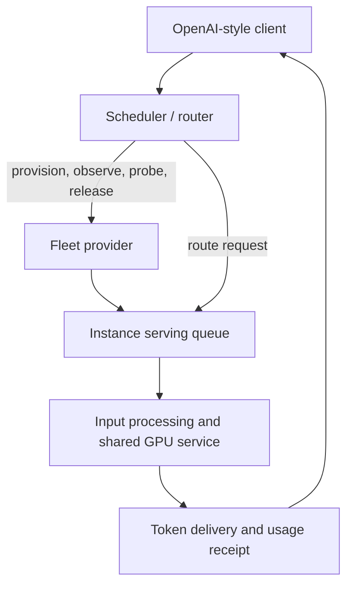

# Inference fleet simulator

Inference Fleet Simulator is a Rust library and HTTP service for developing inference schedulers. It models GPU instances, model startup, input processing, bounded batching, token delivery, and billing. A scheduler receives known request inputs and observable host state, then decides where to route requests and when to provision or release capacity.

The simulator runs locally. It produces synthetic text and does not load model weights or contact a GPU provider. Hardware profiles distinguish measured observations, adjusted estimates, and assumptions; simulation results are experiments against those profiles, rather than claims about live hardware.

## Run the HTTP service

Use Rust 1.98 or later. The package uses the Rust 2024 edition.

```sh
cargo run --release -- serve --bind 127.0.0.1:8080
```

The convenience routing endpoint accepts model requests at `http://127.0.0.1:8080/v1/chat/completions`. The bundled controller selects a compatible host or provisions one. This routing layer uses the same `Scheduler` interface as offline replay.

```sh
curl http://127.0.0.1:8080/v1/models
curl http://127.0.0.1:8080/v1/chat/completions \
  -H 'Content-Type: application/json' \
  -d '{"model":"qwen3.5-2b","messages":[{"role":"user","content":"Hello"}],"max_tokens":32,"stream":true}'
```

Use the exact model identifiers returned by `/v1/models`. For an independent scheduler, use `/v1/offerings` and `/v1/instances` to provision and observe hosts, then send requests to an instance's serving endpoint. Instance admission queues represent the serving engine; the router's global queue determines which host receives a request. See [API behavior](docs/API.md) for request schemas, streaming, probes, and clock control.

`--clock-rate 1` advances one simulated second per real second. Set it to zero for deterministic manual advancement through `/control/advance`, or increase it for accelerated HTTP experiments. Supply `--profiles profiles.json` and `--environment environment.json` to configure hardware and provider conditions.

## Replay workloads and test controllers

```sh
cargo run --release -- init --out data
cargo run --release -- suite --seeds 3 --out results/suite
cargo run --release -- fuzz --cases 1000 --out results/fuzz
cargo run --release -- bench --sizes 1,100,1000,10000 --repetitions 3
cargo test --all-targets
cargo clippy --all-targets -- -D warnings
```

`init` exports editable JSON hardware profiles and workload traces. `run` replays a custom trace with a selected policy; `validate` checks its configuration. Each run records request timings, per-instance costs, unfinished work, controller diagnostics, and a fleet timeline. Policies currently include warm-only, reactive scaling, cheapest elastic capacity, planned hybrid, and adaptive probing. Their tradeoffs depend on the workload and profile assumptions.

Implement `Scheduler::decide(&FleetView)` to test another controller. The view includes model identity, input tokens and bytes, output estimates and hard limits, observed progress, and announced workload plans. Actual future output and sampled host reality stay inside the engine. [Architecture](docs/ARCHITECTURE.md) explains the physical model and scheduling contract. [Calibration](docs/CALIBRATION.md) explains how to build useful profiles from measurements.



[Configuration](docs/CONFIGURATION.md) defines the knobs for each layer. [Validation and results](docs/RESULTS.md) records reproducible policy comparisons and the test gauntlet. The `bench` command measures simulator CPU execution time separately from virtual GPU throughput; `--max-seconds` optionally enforces a host-specific regression budget. Seeded fuzzing saves any failing configuration for replay.

## Model boundaries

GPU service uses configurable aggregate capacity curves with weighted sharing, rather than kernel-level emulation. Input processing and image work use explicit coefficients; KV admission reserves input plus the hard output limit. Image, model, and adapter caches affect loading. Prefix-cache savings are supplied as an input estimate. Network bandwidth is a per-request link approximation, rather than a topology or shared-link model.

The OpenAI-compatible surface supports synthetic chat completions and streaming. It is a serving-behavior test fixture, not a model-quality evaluator or a complete implementation of every OpenAI API. Without explicit simulator token metadata, text token counts use a documented byte-based approximation.

MIT licensed. Contributions should include behavioral evidence and reproducible fixtures; see [Contributing](CONTRIBUTING.md).
